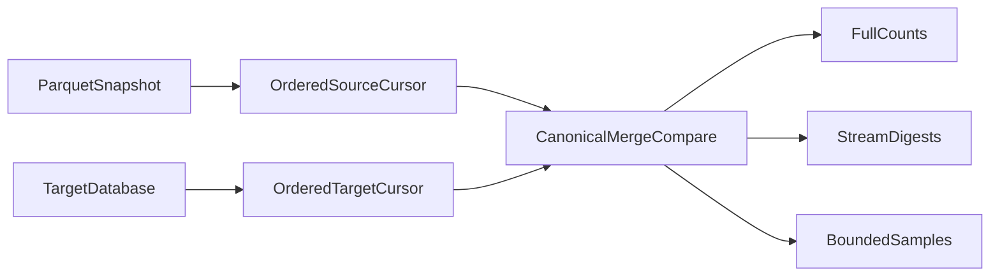

# Architecture and review guide

## Execution boundaries

A bounded-memory migration auditor merge-compares ordered database cursors, validates primary-key uniqueness, canonicalizes cross-engine numeric and timestamp values, computes full-stream SHA-256 digests, and emits bounded discrepancy samples with complete difference counts. It includes real Parquet/DuckDB and PostgreSQL DB-API adapters, a CLI with meaningful exit codes, and a 5,000-row fault-injection fixture.

## Decisions to review

Source and target must represent the same extraction cut. PostgreSQL uses a read-only repeatable-read transaction; cross-system snapshot coordination remains an orchestration responsibility. The key must be one consistently typed, consistently collated sortable column. Column names and values are audited; physical storage types are not declared equivalent. Monetary comparison is exact, not tolerance-based. PostgreSQL integration requires a live server; local tests exercise DuckDB cursor streaming.

## Failure exercise

1. Run the supplied synthetic example and record its state or output.
2. Run the same input again. Inspect the replay policy: event/batch idempotency for transactional systems, stable latest-state results for CDC, pinned versions for contracts, and explicit output prefixes for Beam.
3. Introduce a malformed input and run the tests that exercise rejection. Check whether the contract requires quarantine or whole-batch failure before re-running.
4. Stop the persistence service during a write when using a deployed topology. Confirm that the consumer/scheduler does not advance its source checkpoint before the sink commits.
5. Recover from the retained input. Inspect receipts, rejects, run metadata, or comparison reports instead of assuming a successful process exit implies end-to-end correctness.

Steps requiring Kafka, PostgreSQL, Airflow, Spark, or containers are deployment exercises, not claims that those environments were tested here. See `VALIDATION.md` for executed evidence.

## Portfolio discussion

Be prepared to explain the input grain, key/version contract, transaction boundary, retained state, failure recovery, and the changes required for multiple workers or a cloud deployment. The implementation deliberately exposes these decisions rather than claiming scale from a small synthetic example.
